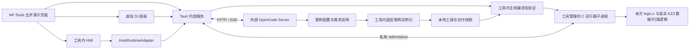

# NP-Tools 工业 AI 全流程仿真演示设计

版本：v2.0（固定案例、本地主机仿真、NP-Tools 一体化）  
修订日期：2026-10-19  
用途：上海工博会现场连续演示；本版替代此前以实板烧录为默认路径的方案。

> 演示全程在 NP-Tools 内完成：导入 KZ3 点表 → 输入需求并对话 → 从固定案例生成控制代码和北向点表 → 编译并启动本地仿真 → 对话生成 HMI → 模拟 DI、观察 DO 和调参。只有 OpenCode Server 通过地址连接。仿真执行本次生成的 C 控制逻辑，不是前端播放预设时序动画。
>
> 2026-10-19：已在 NP-Tools 实现五步页面、固定案例生成、真实 C 主机运行器和 HMI，并完成本机 OpenCode 1.19.2 + deepseek/deepseek-flash 实际联调。实施差异、命令和验收证据见 [实施与验收记录](实施与验收记录.md)。本文中“拟新增”及接口建议保留为设计基线，实际契约以实现记录为准。软件仿真不代表 ARM 构建、烧录、实际电气时序或现场验收。

## 1. 产品边界与完成标准

### 1.1 用户只使用一个工具

| 内容 | 在哪里完成 | 用户看到的操作 |
|---|---|---|
| OpenCode | 本机已运行的外部 Server | NP-Tools 中填写服务地址并连接 |
| 点表 | NP-Tools 导入、检查和保存 | 导入 `project_io.yaml` |
| 需求 | NP-Tools 对话与方案卡 | 输入要求、选择建议、确认方案 |
| 代码与北向点表 | 工具内部调用固定案例实例化程序 | 查看代码、参数差异和点表 |
| 主机编译与验证 | NP-Tools 内部任务 | 显示实际进度、错误和结果 |
| 仿真部署 | NP-Tools 启动自己管理的运行器子进程 | 点击“部署到本地仿真” |
| HMI | NP-Tools 内部 Vue 页面 | 对话生成配置，自动加载画面 |
| DI/DO 模拟 | NP-Tools 输入面板与 C 运行器 | 按按钮、切许可、看输出及阶段 |

不要求用户另开终端、浏览器、仿真软件或后台服务。内部运行器是桌面应用管理的工作进程，无监听端口、无独立安装界面，关闭应用时一并结束。案例、技能集成资源、构建驱动和运行器底座随演示包准备；OpenCode 负责模型调用。

AI 角色为“现场实施协作工程师”；现场价值是理解需求、补齐控制约束、把需求转成正确的案例配置。演示模式不让模型自由重写 C 状态机。

### 1.2 五步连续流程

| 步骤 | NP-Tools 页面内容 | 出口 |
|---|---|---|
| 1 硬件点位 | KZ3 板型示意、5 个已用端子、原始点表 | 类型、角色和板载映射匹配；标明虚拟输入 |
| 2 需求沟通 | 自然语言需求、AI 补全建议、两个时间参数 | 当前需求确认且属于固定案例能力 |
| 3 生成工程 | 固定案例来源、代码、13 个北向字段、验证结果 | 当前实例的源码及 host 检查通过 |
| 4 部署仿真 | 主机编译、启动运行器、工程身份握手 | 当前交付版本运行，首个有效快照已收到 |
| 5 HMI 调试 | 对话生成 scene、虚拟 DI 面板、输出与阶段 | 同一版本控制代码响应输入和参数，结果可复现 |

本期只有一台电脑、一个固定案例、一个活动运行器；不依赖 KZ3 实物、ST-Link、串口、网线、ARM 工具链或外部 I/O 工装。既有实板工具功能保持独立，不进入本次演示入口。

“硬件点位”表示代码面向 KZ3 板型的逻辑资源；“部署到本地仿真”表示启动主机可执行程序。界面持续显示“本地仿真”，不显示假 SN、假设备 IP、“烧录完成”或“实板在线”。

## 2. 现有能力与本次新增缺口

源码核对基线为 NP-Tools `1.0.8 / 2cb65d3`、KZ3 `be833d2` 及当前工作区的新技能。正式演示包应记录实际提交和未提交资源哈希。

| 已有能力 | 可复用 | 必须新增 |
|---|---|---|
| Vue 3/Tauri 2/Rust/Pinia | 页面、状态、IPC、进程管理基础 | AI 五步页与模拟运行界面 |
| YAML 工程表、北向导出 | 结构显示、字段类型、CSV/Excel | 无损导入、固定案例检查 |
| KZ3 DataManager/LogicManager | 真实参数、命令、扫描与状态逻辑 | 持续交互的 host runner |
| `verify_project.py` | 隔离生成、C11 编译、真实 host 扫描测试 | 单独的运行器构建驱动；不能拿一次性测试程序作常驻仿真 |
| `kz3-control-engineer` | 工艺需求设计和既有工程约束 | 固定案例配置路由、仿真证据范围 |
| `.scene.json` 样例 | 设备与北向字段绑定形式 | HMI renderer、场景校验、HostRuntimeAdapter |
| 实板 HTTP 调试 | 字段描述、部分纯校验逻辑可参考 | 仿真专用通道；不调用实板 HTTP，不复用实板写许可状态 |

已核对可用 API：`DataManager_PublishBoolInput`、`DataManager_SubmitBoolCommand`、`DataManager_WriteParameterU32`、`DataManager_CopyProcessSnapshot`、`LogicManager_Init/Step/Stop`。参数写入 API 带 revision/CAS；新仿真通道应保留它，而不是沿用现有 HTTP 缺少 CAS 的限制。

已有 verifier 链接 `logic.c`、生成的 `point_config.c`、data/logic manager、parameter/runtime store、EEPROM fake。这证明源码具备主机测试底座，不代表已经存在持续运行、可连接 HMI 的仿真服务。

两个已发现的问题仍需解决：

- `yamlHelper.ts` 往返序列化会补默认值并遗漏部分字段，例如 contract/input_quality/startup 部分配置。原始输入必须原样归档，完整文档树保留未知字段，禁止 UI 默认值冒充用户提供事实。
- 指定 `iot1-1.scene.json` 的 source 版本为 1.8.3，而同目录点表是 1.8.4。只借用配置结构，不能绕过版本检查直接上线。该旧案例含模拟量和扩展模块，不复制为本次案例。

## 3. 固定案例与模拟点位

完整行为基线见 [KZ3 板载顺序启停案例](KZ3板载顺序启停案例.md)。名称保留“板载”，是为了说明目标点位归属；本次执行方式为主机仿真。

| 点位 | 角色 | NP-Tools 控件 |
|---|---|---|
| `board.di01` | 启动，取上升沿 | “按下启动”脉冲按钮 |
| `board.di02` | 正常停止，电平有效 | “按下停止”脉冲按钮 |
| `board.di03` | 运行许可 | 保持开关，初始关闭 |
| `board.do01` | 后级控制输出 | 只读指示，来自运行器快照 |
| `board.do02` | 前级控制输出 | 只读指示，来自运行器快照 |

正常启动 DO1 先接通，默认 2 秒后 DO2 接通；正常停止 DO2 先断开，默认 5 秒后 DO1 断开。许可撤销或输入质量异常立即撤销两输出；恢复后等待新启动。没有实际运行反馈、故障复位、手自动模式、PID 或拓扑变化。

现场只允许修改名称和两个 1000–10000ms 的整数参数；本轮启动时锁定参数，活动周期不受后来写值影响。点表里的五个 source 固定核对，不能自动换绑不存在的点。

软件模拟使用驱动转换后的逻辑布尔值，不因板型 DI 的 `active: low` 再次取反。模拟点由虚拟采样器产生，初始值明确为 DI1=false、DI2=false、DI3=false、两 DO=false。板型极性保留作目标说明，但不声称验证了物理电压、接线或继电器。

## 4. 一体化架构



只有 OpenCode 是外部地址连接。图中的其他模块均属于 NP-Tools 的内部功能或其受控子进程；不建立独立 Node/Java/Python HTTP 服务。

本地编译驱动可使用已准备的 Python 脚本和 C 编译器作为工具内部子进程，通过参数数组调用、捕获日志，无需用户操作终端。展会电脑预装/随包准备兼容运行环境，工具启动时自动检测并给出可读缺项，不能临时在线下载安装。

工程文件存入现有 workspace 下的 `ai-projects/<id>/`，不要求设备 SN。演示包在 NP-Tools 管理的 `<workspace>/sdks/kz3/<baseline>/` 准备完整、固定基线的 KZ3 专用工作副本（包含新agent/skill、生成器和API）；所需源码/资源随受控演示包提供，路径由工具配置及校验，现场不要求用户再操作外部SDK工程。工程目录由 Rust 创建、校验并传给 OpenCode。主机编译在隔离 staging 内进行，不改生产 active project、不调用 `build_release.sh` 或烧录服务。

## 5. 页面与展示设计

导航名称“AI 工程演示”，五步导航为“硬件点位 / 需求沟通 / 生成工程 / 部署仿真 / HMI 调试”。所有步骤共享当前工程、需求修订和会话，前一步的产物自动交给后一步。

需求阶段用“资料抽屉＋对话＋方案/代码视图”；调试阶段将主要空间交给 HMI，并把虚拟 DI 固定在右侧。默认虚拟输入面板始终可见，避免观众不知道由谁触发输入。

```text
┌ AI 工程演示   当前工程 r0001     本地仿真运行中    AI 已连接 ┐
│ 硬件点位 → 需求沟通 → 生成工程 → 部署仿真 → HMI 调试       │
├─────────────────────────────────────────────────────────┤
│ 后级输出 DO1       →      前级输出 DO2    │ 虚拟输入      │
│ 接通/断开                 接通/断开       │ DI1 [按下启动]│
│ 当前步骤：等待前级接通    剩余 1.2s        │ DI2 [按下停止]│
│                                         │ DI3 [运行许可]│
│ [启动] [正常停止] [立即停止]              │ 当前采样值    │
│ 启动间隔 2000ms     停止延时 5000ms        │ [重置演示]    │
├─────────────────────────────────────────────────────────┤
│ 对话 / 当前代码 / 北向点表 / 执行记录（按需展开）           │
└─────────────────────────────────────────────────────────┘
```

虚拟 DI 操作与 HMI command 是两个输入来源，必须在事件记录里区分；最终进入同一份控制程序。输入按钮的在途状态、PLC 读取值和输出状态分开显示。HMI 不自行推导 DO 或阶段。

视觉建议延续雾白 `#F2F5F8`、白面板 `#FFFFFF`、深蓝文字 `#142C43`、蓝色主操作 `#146C94`、绿色有效态 `#18794E`；正文 16–18px，设备状态 22–28px，按钮至少 44px。状态用文字与图标，颜色辅助。只在真实快照变化时更新输出指示，不添加伪造运行动画。

1920×1080 展台模式收起资料；1440×900 正常双栏；1366×768 保留三个 DI、两个 DO 和停止动作可见。不要求手机端。进度来自真实程序事件；不输出假百分比、隐藏思考过程或未经统计的效率数字。

## 6. 点表、需求与固定模板

### 6.1 导入与需求确认

接受 `.yaml/.yml/.ymal`，内容为 `kz3-project-io/v3`；保留原始文件、文件名和 SHA-256。建议 5 MiB 上限，限制深度/节点数，拒绝重复 key、多文档、非允许 tag 及异常别名展开。缺失信息保持缺失，不自动补一个 source/reference。

依据本例要求核对 3 DI/2 DO、类型、角色、唯一性和北向冲突。模拟配置中 source 表示虚拟板载地址，不要求真实接线照片或实板极性验收；这些事实不能伪造为已完成。

沿用需求契约，但要增加明确的 `host_simulation` 交付范围与证据口径。仿真输出安全值可依据固定案例和主机测试确认；物理电气、烧录、HIL 标为本次不适用/未执行。实现前检查现有 verifier 是否能表达该范围；若不能，作有范围限制的扩展并增加回归测试，不机械把物理确认项改为 true，也不放宽实际硬件项目的门禁。

简短需求由 AI 补齐：启动自保持、正常停止顺序、停止优先、许可撤销、恢复不自启、输入异常、参数快照。用户只选择案例支持的时间和名称。新增第三台设备、PID 或改变保护策略时说明超出固定案例，记录后续需求，不现场自由编程。

### 6.2 固定案例包

```text
expo-cases/two-device-output-sequence/1.0.0/
  case.json                      # 能力、允许参数、source和哈希
  README.md                      # 固定行为、需求说明骨架
  project_io.template.yaml
  logic.c                        # 固定核心实现
  logic_project_test.c            # 固定断言/边界测试
  scene.template.json
  scene.bindings.template.json
  qualification/                 # 模板级 host 证据；无 HIL 伪称
host-runtime/
  runner_main.c                  # 私有 IPC 与扫描驱动适配，待新增
  runner_protocol.*              # 有界解析、类型检查、序列校验
  build_host_runner.py            # 应用内部调用，待新增
```

这些是拟新增交付，不是当前已存在的完整仿真引擎。案例代码与运行器由开发阶段实现验证；现场 AI 只给配置，应用程序填模板、调用生成器并编译。

AI 配置候选示例：

```json
{
  "schema": "np-tools-expo-case-config/v1",
  "caseId": "two-device-output-sequence",
  "caseVersion": "1.0.0",
  "projectId": "expo_sequence_demo",
  "projectVersion": "1.0.0",
  "bindings": {
    "startButton": "board.di01",
    "stopButton": "board.di02",
    "runPermit": "board.di03",
    "downstreamOutput": "board.do01",
    "upstreamOutput": "board.do02"
  },
  "parameters": {"startDelayMs": 2000, "clearDelayMs": 5000},
  "labels": {"downstream": "后级输送设备", "upstream": "前级输送设备"}
}
```

schema 不接受未知键或代码片段；固定 source 不可改，两个参数为 1000–10000 整数，文本只用于允许的位置并正确转义，不能成为 C 标识符、shell 命令或路径。AI 不编辑核心 logic/test/runner。程序核对模板哈希后确定性落盘，相同有效输入产出相同工程内容。哈希、任务通过状态和版本关联由工具生成。

当前实例仍执行严格 host 测试。参数/映射变化不能直接继承旧 PASS。失败最多返回一次配置修正；代码/模板缺陷停止并报告，不进入反复重写 C 的循环。

### 6.3 北向唯一来源

固定 13 个字段见案例文档：三个 DI、两个 DO 输出映像、三个 command、两个 u32 参数、阶段/阻止原因/剩余时间三个 state。定义以正式 `project_io.yaml` 的 northbound 为准，说明、表格、HMI 和运行器读取映射都从这份数据派生。

仍用原生成器检查 reference/类型/权限/宽度，保留前导零。模拟 DI 不是新增北向可写点，属于独立的输入注入接口；DO/state 始终只读。运行器不提供任意字段/内存写。

## 7. OpenCode 对接设计

### 7.1 服务基线与检查

建议开发启动方式（实施时执行，不是本轮已启动）：

```sh
cd /绝对路径/专用KZ3演示副本
opencode serve --hostname 127.0.0.1 --port 4096
```

NP-Tools 默认连接 `http://127.0.0.1:4096`，允许填写其他回环端口。第一期限定同机回环地址；不开放局域网远程服务。若服务设置 HTTP Basic 认证，通过应用内部连接配置传递，凭据仅驻内存或使用系统密钥存储，禁止写入工程包/日志。

连接检查分四层：服务健康、工作目录有效、指定 agent 存在、所选模型可用。模型列举不代表模型实际可调用；展前使用无硬件副作用的小任务验证一次。官方支持独立 server、session 和事件 API，详见 [OpenCode Server 文档](https://docs.opencode.ai/docs/server/)。

此前核查的本机 CLI 为 1.19.2，工作区 SDK 为 1.18.21，当时服务未连通。本设计中的接口参考官方文档与已安装 SDK 类型，必须在 P0 联调时获取实际 `/doc`、记录服务版本/契约摘要；不能宣称这些请求已在 1.19.2 上实测。

### 7.2 接口清单

所有工程级请求使用同一个经过编码的 `directory` 查询参数；不能把它错误放到创建会话 JSON 中。路径、会话 ID 与工程关系由 Rust 保存，不由模型随意提供。

| 意图 | HTTP 接口 | 备注 |
|---|---|---|
| 健康/版本 | `GET /global/health` | 与设备健康分开展示 |
| 契约检查 | `GET /doc` | 保存兼容快照；实际返回形式按服务确认 |
| agent 发现 | `GET /agent?directory=...` | 必须包含 `kz3-control-engineer` |
| 模型发现 | `GET /provider?directory=...` | 不读取/导出凭据 |
| 建会话 | `POST /session?directory=...` | body 使用 `title` |
| 流式事件 | `GET /event?directory=...` | SSE，应用端按 sessionID 过滤 |
| 发送消息 | `POST /session/{id}/prompt_async?directory=...` | 204 仅为接收，不是任务完成 |
| 恢复消息 | `GET /session/{id}/message?directory=...` | 保存消息/part 主键；历史分页按服务能力 |
| 当前状态 | `GET /session/status?directory=...` | 恢复和超时判定 |
| 停止生成 | `POST /session/{id}/abort?directory=...` | 完成后重新核对文件；不自动回滚 |
| 待回答问题 | `GET /question?directory=...` | 本地 SDK v2 中可见，P0 确认 |
| 回答问题 | `POST /question/{requestID}/reply?directory=...` | `{ "answers": [["选项文本"]] }`；顺序对应问题 |
| 拒绝问题 | `POST /question/{requestID}/reject?directory=...` | P0 确认 |
| 待授权事项 | `GET /permission?directory=...` | 本地 SDK v2 中可见，P0 确认 |
| 回复授权 | `POST /permission/{requestID}/reply?directory=...` | `{ "reply": "once" }` 或 reject；不默认 always |

官方页面同时存在旧的 session permission 路径说明。本地 SDK 新路径与官方概览差异须由兼容适配器处理，只选择实际探测通过的一套接口。没有 question API 时，业务选项可退回普通文本消息；如果服务仍产生原生挂起问题，必须可处理或明确中止，不能只在 UI 假装已回答。无可用 permission 回复能力时阻止需要授权的任务继续。

发送示例：

```json
{
  "agent": "kz3-control-engineer",
  "parts": [
    {
      "type": "text",
      "text": "请按本工程的 context.json 和原始点表检查两设备联动需求。先完善方案；物理事实不完整时给出可演示的替代方案。"
    }
  ]
}
```

真实请求应包含受控相对文件路径、输入哈希和修订号。模型可沿用服务已选默认值；显式指定时使用服务返回的 providerID/modelID。不要把厂商模型名称写死在业务代码。

### 7.3 SSE 与恢复规则

Rust 单独建立 OpenCode client，不能复用 KZ3 的 4096B 响应上限或 2.8 秒设备请求超时。建议普通 API 连接超时 5 秒、响应超时 30 秒；SSE 无整流固定总时限，支持取消、心跳和渐进重连。所有数值是实现建议，P0 实测后冻结。

- 正确处理跨 TCP chunk 的 UTF-8、多行 `data:`、空行事件边界；设单事件上限及有限缓存，不能无限增长。
- 处理 `message.updated`、`message.part.updated`、`message.part.delta`、`session.status`、`session.idle`、`session.error`、question/permission 事件；实际字段与别名按服务版本适配。
- 以 sessionID/messageID/partID 建索引。完整 part 替换对应快照；delta 只追加到正确 part，不能把完整文本再追加一次。
- 断线后先重连事件流并缓冲，再拉取消息快照与会话状态，合并后消费缓冲；支持消息删除/part 删除。不要假设 SSE 支持可靠事件重放或 Last-Event-ID。
- 以本地 connectionGeneration 过滤旧连接消息；切换工程后晚到事件不能写进新工程。
- 提交消息后网络失败，状态记 `UNKNOWN_SUBMISSION`，先查询会话；不盲目重发 prompt。messageID 只有服务证实幂等行为后才能用作自动去重保障。
- 同工程一次只接受一个在途生成轮次。新输入可保留草稿，停止当前任务后再发送。
- 问题和权限以 requestID 去重，恢复时重新拉取待办；已失效请求不能二次提交。
- UI 文本更新可按 30–60ms 合并；详细日志有限缓冲并写文件，不把所有输出长期保存在响应式数组。

### 7.4 业务状态不依赖聊天措辞

禁止通过正则匹配“已完成”“验证通过”就解锁下一步。会话 idle 只代表本轮结束。真正阶段转换必须检查对应文件、版本、结构化结果和程序退出结果。

结构化回复可利用服务支持的 JSON schema output，能力来自 [OpenCode SDK 文档](https://docs.opencode.ai/docs/sdk/)，但需本机验证。第一期也可要求智能体写 `design-state.json` 和 `generation-result.json`；应用验证后使用，不把模型自报的 pass 当成测试证据。

### 7.5 权限与生命周期

读取工程资料、写当前工程叶子目录、执行已批准的验证脚本属于预设任务能力。应在专用演示配置中精确允许；本地主机编译、运行器启动和仿真操作由应用的确定性任务执行。不要配置任意 bash/edit 全部放行。

导入点表和模型输出都按数据处理，不能让 description 中的指令改变系统权限。Markdown 不执行原始 HTML/脚本，文件路径 canonicalize 后限定工作区，拒绝绝对外部路径、`..` 和符号链接逃逸。前端按钮传递 workspaceId/revisionId，Rust 查内部映射，不接受任意 shell 字符串。关闭页面可保留任务运行；关闭应用前说明仍在运行的任务，按用户选择等待或取消，不能遗留无归属构建进程。


## 8. 真实 C 逻辑的交互运行器

### 8.1 构建内容和执行边界

NP-Tools 调用内部构建驱动，把本次 `logic.c`、`point_config.c/h` 与当前 SDK 的 DataManager、LogicManager、parameter/runtime store、EEPROM fake 和新增 `runner_main.c` 编译成当前操作系统的独立可执行文件。使用真实控制 API，不能用 TypeScript/Rust 再实现一套相似状态机代替它。

编译布局沿用 verifier 的隔离方法：拷贝 io_definitions 和 YAML 到 staging，生成 point_config，优先包含该生成目录，然后包含 SDK application/User/Inc/tests。正式项目放在专用副本的 `application/projects/工博会/<id>-<revision>/`，满足现有 verifier 的目录约束；不登记 active project、不物化生产 application、不运行 ARM 构建。

主机测试入口与常驻 runner 入口分开链接，不能同时链接两个 main。测试和 runner 使用完全相同的生成源码与 SDK 基线；runner 使用自己的 IPC 驱动，不直接运行 verifier 的临时测试二进制（该目录会被清理）。

进程启动前由 Rust 校验产物白名单、路径、哈希、ABI/操作系统和协议版本；不执行模型提供的任意二进制或命令。候选编译成功不等于已运行，需完成握手和第一个扫描快照。

第一期在实际展会电脑平台验证即可；当前开发环境为 macOS。若改用 Windows，必须先验证对应 host 编译器、runner 协议和进程清理；现有 macOS host-tests preset 不是 Windows 可用性证据。展前冻结 Python/PyYAML、C 编译器、运行器解析依赖及 SDK，不在会场临时下载。

### 8.2 生命周期与本地“部署”

运行器状态：`STOPPED → BUILDING → STARTING → READY → RUNNING`，失败为 `FAILED`；控制逻辑自己的 READY/START_DELAY 等状态独立展示。

“部署到本地仿真”执行：

1. 检查当前需求、案例配置、源码与测试结果为同一修订。
2. 在独立目录编译候选 runner；旧运行版本可继续存在但 UI 明确显示旧修订，不能展示为新版本。
3. 候选进程以无扫描的握手状态启动，Rust 比对身份与协议。失败不切换当前运行版本。
4. 切换时关闭旧版本操作入口、正常停止并结束旧进程，清空旧命令队列；必要时超时终止。
5. 为候选分配新的 `runId/epoch`，初始化虚拟 DI 全 false、参数为生成默认值；核对首个输出安全快照后打开调试界面。
6. 两个候选即使短暂共存，也只能有一个接受输入并运行扫描；未激活候选不得自行计时。

“重置演示”使用同一交付二进制启动新 runId，清空计时、命令、输入及临时参数；DI3 回关闭，两输出断开。它是演示运行环境重置，不是 PLC fault reset 命令。“停止仿真”停止扫描并结束进程，最后值显示为历史，不伪称进程退出后仍有有效 DO 状态。

应用退出关闭子进程组；前端页面切换保留一个后台运行会话，回到页面拉最新快照，不重复启动。应用重启先显示上次工程但不自动继续输出或重放输入。子进程 stdin EOF 必须退出，防止主应用崩溃后遗留扫描进程。

### 8.3 扫描时钟与线程 owner

- Rust 内部 actor 是唯一时钟与请求 owner，通过私有管道驱动 runner 单线程。所有 DataManager/LogicManager 操作在 runner 的同一执行线程完成，IPC 读取线程若存在只负责队列，不并发改逻辑上下文。
- 本例扫描目标周期为 10ms，与生成 YAML 一致；由 Rust 单调时钟计算本次相对 `now_ms`，不使用浏览器定时器、系统日历时间或 AI 生成时间。
- 一个 tick 只允许一个在途请求；先应用边界输入和命令、再 `LogicManager_Step`、最后读取完整快照。同一 tick 的停止优先行为由模板确定，不由消息到达的字符串顺序推断。
- 桌面系统非实时系统。少量调度延迟时传真实单调经过时间，记录 scan gap；不伪称精确 10ms 硬实时，也不以大批快速补扫描伪造稳定运行。
- 若距离上一扫描超过建议阈值 250ms（展前压测后冻结），或一次 IPC tick 在规定时间内未响应，进入 `RUNTIME_STALLED`，冻结写入并停止当前运行会话，要求重新启动；不在电脑休眠后突然补完长时间启停流程。
- 前端最多按 100ms 节奏显示完整快照；PLC 扫描保持独立。剩余时间来自 C 状态，前端只格式化显示；不得先于收到快照宣称计时已到。
- 单元/回归测试可用可控时间步直接覆盖 1999/2000ms 等边界及 uint32 回绕；演示只用 1×墙钟推进，不提供快进/暂停后自动继续功能。

### 8.4 DI 注入、脉冲和质量

虚拟 DI 面板调用独立 `sim_input` 路径。只有当前模板的 board.di01/02/03 可注入；DO/parameter/state 不接受此路径。

DI1/DI2 点击产生一次约 100ms 的逻辑 true 脉冲，脉冲生成和释放由 Rust 运行 actor 管理，且必须至少在一个已完成的扫描里被读取。不要把鼠标按下/松开直接塞进同一批输入导致脉冲被覆盖；UI 即使失去焦点也会自动释放。重复点击同一在途脉冲返回 busy，不堆积以后才执行。

DI3 是保持值，初始 false，用户切换后持续采样。虚拟采样器每次扫描发布三个 DI 的当前值、GOOD 质量及本次采样时间；这是对虚拟源的真实重新采样，不冒充硬件采集。诊断测试的坏质量注入独立于正常控件，启用后不得被下一扫描自动覆盖成 GOOD。

应用进入 RUNNING 前先初始化输入，再初始化/扫描控制逻辑；首次扫描输出断开。模拟上电时启动按住的边界用专门测试，不依赖浏览器能准确制造上电边沿。

`DataManager_PublishBoolInput` 的具体 bind（board source 或生成逻辑别名）必须由当前生成器描述符确定，并通过输入读回测试验证。不能根据界面标签猜 Point ID 或把 DI source 直接当内存索引。

### 8.5 HMI 命令、参数及保护

HMI 命令从 northbound name 找到当前生成定义的 bind，再通过 `DataManager_SubmitBoolCommand(..., true)` 提交。模板的 LINE_START/STOP/PROTECT_STOP 是应用命令，不能误映射成 `controller_start/controller_stop/controller_reset`，否则会改变整个 LogicManager 生命周期。

参数通过 `DataManager_WriteParameterU32`，带当前 expected_revision，冲突时回报并刷新，不能静默覆盖。两参数可单独写入：每次展示实际值，写失败不声称一组同时更新。控制器模板启动时锁定两参数快照；UI 仅待命可改，runner 也检查参数范围和状态。运行器通道使用真实 parameter revision，不虚构 CAS。

输入 DI 与 HMI command 可在同一扫描触发同一意图，模板逻辑按一个事件处理；保护/停止优先。返回值分“接收请求”“扫描已应用”“按当前规则允许/忽略”。运行中点启动被忽略不等于通信错误；输出是否接通以随后的快照为准。

### 8.6 私有管道协议（拟新增）

使用 UTF-8 单行 JSON（JSONL），stdout 仅协议，stderr 为有界日志。每行建议不超过 64KiB，限制嵌套深度/数组长度/字符串长度，拒绝未知操作和无效数值。解析库/实现固定版本并随包准备，不能手写字符串搜索作为 JSON 解析。

所有输入命令和响应关联 `protocolVersion/workspaceId/deliveryRevision/runId/epoch/requestId`；runner 在 run 内按 requestId 去重，重复请求不得重复执行。缓存有界，历史 ID 过期时返回 stale，不重新执行。正常路径不因超时自动重放命令；先检查运行器状态。

| 操作 | 谁发起 | 行为 |
|---|---|---|
| hello | Rust→runner | 读取协议、工程、源码/配置身份、northbound manifest |
| activate | Rust→runner | 初始化虚拟输入和逻辑，分配 run/epoch，候选开始受控扫描 |
| tick | Rust→runner | 带 now_ms、输入变化、command、parameter 操作；执行一个完整扫描 |
| snapshot | Rust→runner | 获取同一完成扫描的完整状态，不额外推进时间 |
| shutdown | Rust→runner | 停止并结束进程；EOF 同样退出 |

tick 示例仅说明内部协议，属于待实现契约：

```json
{
  "protocolVersion": 1,
  "runId": "run-001",
  "epoch": 1,
  "requestId": "tick-42",
  "op": "tick",
  "nowMs": 420,
  "inputChanges": [{"source": "board.di03", "value": true}],
  "commands": [],
  "parameterWrites": []
}
```

运行器 hello 内的身份由编译时生成的只读常量提供，不能仅原样回显启动参数。Rust 另核对二进制实际哈希。snapshot 至少包含 scanSequence、nowMs、运行器健康、parameterRevision、全部13个字段的值/质量、三个输入源及命令结果。快照中的工程 ID/版本、manifest 与本地交付一致才接入 HMI。

Rust 检查单调序列、当前 run/epoch，切换后晚到旧事件直接丢弃。输出点值读取 DataManager 的实际生成字段/快照，不能由 Rust 按 timer 算出。出现非法 JSON、协议不匹配、超限、子进程崩溃或缓冲积压即停止该会话并显示原因。

## 9. 交付版本、缓存和持久化

```text
<NP-Tools工作空间>/ai-projects/<workspace-id>/
  workspace.json
  inputs/<revision>/original-project_io.yaml
  requirements/<revision>/README.md
  deliveries/<revision>/
    delivery-manifest.json
    case-config.json
    project_io.yaml
    logic.c
    logic_project_test.c
    point_config.md
    northbound.csv
    demo.scene.json
    scene.bindings.json
    validation/
    host/runner[.exe]
  runs/<run-id>/run.json
  runs/<run-id>/events.jsonl
  presentation/last-passed.json
```

首次需求确认、生成、HMI和运行步骤使用同一 workspace。manifest 由应用生成，记录输入/需求/模板/配置/生成器/SDK/运行器版本、源码树哈希、host 编译器/选项、binary SHA-256、北向 manifest、每项检查及证据路径。

HMI 布局修订可与源码修订分开，显式引用对应 delivery；改变控制字段或参数生成默认值则重新实例化并验证。运行参数微调写运行事件，不把它当作新的源码部署。

前端同时维护当前设计修订与当前运行修订，不能把“新设计生成了”显示成“旧进程已升级”。恢复历史成功版本要明确显示原 revision，不能冒充刚生成结果。

首版不做复杂构建缓存。固定 C 核心可按模板哈希复制；相同完整输入可复用已检查产物并明确显示“复用已验证版本”，但运行器仍按新 runId 冷启动。缓存键至少覆盖当前 source、generated headers、模板、配置、SDK、runner、编译器/平台和选项；不能仅以 logic.c 不变就复用二进制。已有模板 PASS 不能替代新实例测试。

只保存输入、需求、确认、配置、产物身份和必要事件；模型认证信息不写入工程。日志采用有界内存与文件轮转，建议每轮10MiB、最多20轮（实现时冻结），导出前过滤密钥/绝对私有路径。不在程序退出后自动恢复虚拟许可或启动请求。

## 10. HMI：运行器驱动的操作界面

### 10.1 同一对话生成配置

用户在 NP-Tools 对话中说“给这个工程生成 HMI”，AI 返回当前案例允许的展示配置，工具填固定精修 scene 模板，执行 schema/字段绑定校验并在页面内打开。无需复制文件路径、上传网页或打开另一个应用。

沿用核心字段 `name/devices/measurements/parameters/externalInputs/source/notes`。点字符串指向 northbound field.name，不是 Modbus reference 或 C 变量。NP-Tools 特有布局、输出标识、phaseLabels、blockReasonPoint、remainingPoint、inputPoints 和立即停止动作放入声明过 schema 的 `scene.bindings.json`。

核心 scene 和 sidecar 都是受限 JSON，不执行脚本、任意 URL、HTML 或表达式。只实现本例 screen/sensor 控件；不建设通用组态编辑器。

### 10.2 绑定检查与数据通道

- scene.source 的 projectId/version、交付修订、北向 manifest 与当前 runner hello 一致；不一致只能看配置，不能操作。
- 所有状态/参数/命令引用必须存在且类型匹配；两个输出显示为命令映像，不能伪装实际电机运行反馈。
- LINE_START/STOP/PROTECT_STOP 为 bool 单次命令；两个时间参数为 u32/1000–10000；其他字段只读。
- 五态 phase 与案例一致，未知枚举显示未知；block reason 非零显示具体原因。
- 虚拟 DI 面板独立使用模拟注入 API；scene.externalInputs 保持空，不通过普通北向写接口改 DI。
- 当前 runner 的完整快照是唯一运行数据源。不得同时让旧 controllerDebugStore 的设备轮询覆盖同一页面。

新增 `HostRuntimeAdapter`，为 HMI 提供 identity、snapshot、command、parameter 操作；虚拟输入能力单独暴露。第一期只实现 host adapter，不必重构全部实板调试代码。将来实板 adapter 另行适配并保留实板原有身份/权限门禁；本次不因模拟 DI 可写而放宽设备权限。

### 10.3 有效值、断线与停止

正常运行快照显示“本地仿真运行中”。没有首帧、runner 已退出、序列异常、超过建议500ms没有新快照时，显示“状态不可用/运行中断”，停止动画和新写入；保留的最后值以灰色历史值呈现，不能默认 false 显示成已停止。

“立即停止”是当前 C 程序的应用命令；“停止仿真”是结束整个运行器。前者成功不能从按钮点击直接推断，应等确认快照。runner 不响应时立即停止命令也无法保证执行，工具应中止进程并显示运行中断。因为本例没有实物，不把这描述为物理紧急停止。

OpenCode 断开只影响后续对话与生成，现有 host 运行、DI 和 HMI 仍正常。运行器断开不能自动切换成预览假数据。前端短暂失联可由 Rust 保持扫描，但页面恢复后先拉完整快照并核对身份，期间停止接受新前端请求；桌面主进程失效则 runner 因 EOF 退出。

### 10.4 静态预览与主机仿真明确分开

“布局预览”仅检查 JSON 布局，没有运行器时禁用控制，示例值带预览标识。“本地仿真”才执行当前 C 逻辑。第一期不另写前端模拟算法，不开发回放系统或任意代码浏览器仿真。这样避免两套控制实现产生不同结果。

## 11. 拟新增模块和 IPC

所有新增文件放在 NP-Tools 项目中；KZ3 核心源码作为固定基线依赖读取，案例和 runner 资源由演示包管理。不安装另一个桌面仿真器。

| 文件/模块 | 职责 |
|---|---|
| `src/views/engineering/AiEngineeringView.vue` | 五步入口，对话、代码、北向点表 |
| `src/views/engineering/HmiDemoView.vue` | 内嵌/全屏 HMI + 虚拟输入面板 |
| `src/stores/engineeringStore.ts` | 需求/交付/运行版本关联 |
| `src/stores/opencodeSessionStore.ts` | SSE、消息、问题及权限 |
| `src/stores/hostSimulationStore.ts` | run/epoch、快照、输入请求和运行状态 |
| `src/utils/projectIoImport.ts` | 无损读取、固定点位检查 |
| `src/utils/hmiBindingResolver.ts`、`src/api/hostRuntimeApi.ts` | HMI 契约与 host adapter |
| `src-tauri/src/opencode.rs` | 唯一外部服务的 HTTP/SSE 客户端 |
| `src-tauri/src/engineering_workspace.rs` | 归档、实例化、哈希和路径边界 |
| `src-tauri/src/engineering_jobs.rs` | 受控主机编译和测试 |
| `src-tauri/src/host_simulation.rs` | 子进程、扫描 actor、IPC、DI脉冲、退出清理 |
| `resources/expo-cases/`、`resources/host-runtime/` | 固定案例、协议/runner及构建资源（拟定路径） |
| 现有 router/sidebar/lib.rs | 页面、导航与 Tauri 命令注册 |

最小 Tauri API（待实现）：

| 命令 | 输入 | 结果 |
|---|---|---|
| `engineering_import` | 文件选择结果 | 工程及点表报告 |
| `opencode_connect/create_session/send_message/abort` | 本地服务/工程/文本 | 会话及流式事件 |
| `opencode_answer_question/reply_permission` | 当前请求标识与选择 | 待办处理 |
| `engineering_materialize/validate` | 工程、需求修订、案例配置 | 产物及真实检查结果 |
| `simulation_deploy` | 已通过的交付 revision | 编译、握手、替换并运行 |
| `simulation_input_pulse` | 当前 run/epoch、DI1或DI2 | 脉冲请求结果与扫描证据 |
| `simulation_input_set` | 当前 run/epoch、DI3、bool | 许可改变 |
| `simulation_command` | 当前 run/epoch、已允许 command 名 | 接受/应用/拒绝 |
| `simulation_parameter_write` | run/epoch、参数名、值、expectedRevision | CAS结果 |
| `simulation_snapshot` | 当前 run/epoch | 完整快照 |
| `simulation_restart/stop` | 当前工程/运行标识 | 清空重开或停止 |
| `engineering_export` | 工程及交付修订 | 导出文件 |

前端只传内部 id，Rust 解析受控路径；禁止任意 executable/cwd/command 输入。文件路径规范化，阻止 `..`、外部绝对路径及符号链接逃逸。stdout/stderr 持续读取，防止管道满导致进程卡死。所有任务可取消，有进程组与文件清理，不能留下无归属任务。

## 12. 研发顺序和阶段出口

| 阶段 | 工作 | 必须看到的证据 |
|---|---|---|
| P0 证明 host 路径 | 完成固定案例、严格 host 测试、runner最小握手/扫描；确认本机编译依赖 | 同一 logic.c 对DI变化产生真实DO/状态输出；OpenCode 可用 |
| P1 最小全流程 | NP-Tools 内导入、对话、模板实例化、验证、本地部署、虚拟DI与HMI | 一次全新参数版本从需求贯通到可操作仿真 |
| P2 展示打磨 | 五步页、精修HMI、代码差异、阶段结果、错误提示 | 观众能看懂每步因果，所有操作都在工具内 |
| P3 排练与恢复 | 连续运行、断开AI、进程故障、新版本切换、重置演示 | 无假状态、无旧命令重放，上一成功版本可明确恢复 |

先证明 runner 能执行同一份代码，再铺 UI，避免只做出漂亮动画最后无法接入逻辑。host runner 是必需新增功能，不能误当成现有能力而漏排。

规划时间应在 P0 完成后按真实模型/编译耗时估计，不延用原实板方案排期。展前固定模型、源码依赖、操作系统和编译器；生成后本地运行无需网络，但模型仍依赖所配置提供方网络。

## 13. 检查与验收

### 13.1 关键遗漏已补齐

| 原缺口/冲突 | 本版处理 |
|---|---|
| 仍以实板烧录作为默认交付 | 改为 NP-Tools 内部主机编译、部署和仿真；移出硬件依赖 |
| 主机测试被误当交互仿真 | 新增持续runner、私有IPC、扫描驱动和生命周期 |
| DI无硬件如何变化 | 虚拟DI1/2脉冲与DI3保持，注入真实DataManager |
| HMI只会调用设备HTTP | 新增HostRuntimeAdapter，不伪造设备在线、不放宽实板权限 |
| 点击太快导致DI脉冲漏采 | Rust管理脉冲，至少一个完成扫描，释放不依赖鼠标事件 |
| 浏览器后台/电脑休眠改变定时 | 单调时钟和扫描gap检测，异常停会话，不追赶旧启动 |
| 老代码/旧状态串入新HMI | revision、binary hash、manifest、run/epoch握手和过滤 |
| 参数写入绕过真实API | u32 CAS及范围检查，周期参数快照 |
| 无硬件仍要求物理签核 | 明确host_simulation交付范围；必要时扩展契约，禁止伪造物理证据 |
| 工具外还要启动模拟服务 | 运行器为应用私有子进程，无端口、无需人工启动 |
| 默认演示状态不清楚 | 每次运行DI全false、许可关闭、DO安全，重置开新run |
| 一次成功后不能重复展示 | 重启、版本恢复、连续循环、日志与依赖冻结 |

### 13.2 自动测试清单

- 点表重复key、缺角色、错误类型、source冲突、未知字段保留、输入上限与路径逃逸。
- 案例配置越界/未知键拒绝、模板哈希、同输入确定性、模型不能改固定logic/test。
- 模板全部控制边界：停止优先、计时到、启动等待中停止、重复停止不延时、许可恢复不自启、输入质量异常、按钮持有和时基回绕。
- runner hello与实际binary身份、坏协议/超长帧、未知op、旧run/epoch、重复requestId、进程退出及stderr回压。
- 脉冲至少跨一次扫描，快速重复点击不排队；DI与command同扫冲突；质量注入不会被正常采样覆盖。
- 参数CAS冲突、范围、运行中改参数、本周期快照不变，下一周期采用新值。
- HMI绑定错版本/错字段/写只读点被拒绝；空快照、失效快照、未知枚举不显示假成功。
- 生成新版本时旧版状态标识正确，部署失败不串版本，重置和重新打开应用不自动恢复输出。
- OpenCode不可用不影响现有runner；runtime不可用不能回退成静态假数据。

使用现有 strict verifier 对当前案例执行真实 LogicManager 扫描并保存 `PLC_EXECUTED_V1` 证据；`HOST_PASS`、`HOST_RUNTIME_READY`、完整演示验收分别记录，不能互相替代。运行器用于展示的日志也不能自动变成全部测试通过。

相关命令由工具内部任务封装（实现时不要让现场用户执行）：

```sh
python3 .opencode/skills/kz3-control-engineer/scripts/verify_project.py application/projects/工博会/<工程目录> --requirements-only --require-frozen --require-engineering-review
python3 .opencode/skills/kz3-control-engineer/scripts/verify_project.py application/projects/工博会/<工程目录> --strict-quality --require-engineering-review --require-execution-evidence
```

同时运行新增 IPC/renderer/store 定向测试、`pnpm build` 与相关 Rust tests；不因本设计修改而现在声称这些已经执行。

### 13.3 全流程人工验收

1. 不接 KZ3、不接ST-Link，打开 NP-Tools，连接 OpenCode。
2. 导入固定5点 YAML，显示板型及“虚拟输入”。
3. 输入2秒/5秒顺序启停要求，确认AI补全规则，查看案例来源和配置差异。
4. 实例化源码、北向点表并严格验证，点击部署到本地仿真。
5. 核对run identity与当前交付，看到许可关闭、两输出断开。
6. 同一对话生成HMI，自动加载，开启DI3；点DI1，观察DO1立即接通、DO2约2秒后接通。
7. 点DI2，观察DO2断开、DO1约5秒后断开；新周期撤销许可验证两输出断开，恢复不自启。
8. 用HMI command重复操作，确认同一逻辑；调整一个时间参数验证下一轮生效。
9. 对话改为3秒/4秒，新实例化和部署，确认新revision/run及新时序，旧输入不重放。
10. 断开OpenCode仍可模拟；结束runner时HMI标不可用；“重置演示”回到初始值。

建议10轮输入输出循环、2小时运行观察、3次从需求到新runner完整排练；这些是计划，未执行。记录各阶段耗时中位数/最大值/失败次数，不预先承诺固定秒数。

界面验收覆盖1920×1080、1440×900、1366×768，三个DI/两个DO/停止动作不被遮挡；截图不能替代逻辑证据，host时序不能替代硬件实时性。

## 14. 会展脚本与恢复

现场主线：**“这是KZ3的板载点表；说出控制需求；AI采用验证过的PLC案例生成工程；在工具内启动这份代码；AI生成HMI，用虚拟输入操作并看输出。”**

每一轮新生成需求都必须运行其对应版本；代码来源明确显示固定案例，不宣称从零创造算法。编译期间展示实际配置差异、北向表和进度，不用假倒计时掩盖等待。

| 异常 | 工具行为 | 恢复 |
|---|---|---|
| OpenCode/模型不可用 | 对话失败，运行中的仿真继续 | 重新连接；或明确打开已验证旧版本讲解 |
| 参数/配置不支持 | 给出错误，不生成任意C | 修改为固定案例支持范围 |
| 编译/测试失败 | 候选不发布 | 保存错误，恢复上一成功交付；不称本轮成功 |
| runner崩溃/时钟严重延迟 | 快照失效，停止写，退出当前会话 | 冷启动同一已核对版本 |
| HMI身份不一致 | 禁用操作并显示差异 | 加载对应scene，不篡改版本绕过 |
| 误触/希望重做 | 立即停止或重置演示 | 新run、DI全false、参数回生成默认值 |

旧版本恢复只用于继续讲解。提前准备固定案例、依赖、技能、host二进制和完整验证证据；静态材料不能冒充实时AI回复或本轮执行。

## 15. 尚待实施验证的事实

- 交互runner目前尚未实现；P0需证明SDK在持续扫描、模拟输入和参数写入下正常工作。
- 完整案例源码尚未编写并通过host测试；已有局部模板不是完整案例资格证明。
- 现有需求契约如何表达host_simulation范围，需要与verifier实际检查对齐；不允许伪造实板签核。
- OpenCode实际运行服务的接口/agent/model兼容与响应耗时尚待联调。
- 展会电脑的host编译依赖、打包路径和平台兼容需实测；macOS先跑通即可，其他OS不默认支持。
- 本版设计检查已补齐主要流程遗漏；只有P0–P3证据通过才能声称演示就绪。

## 附录：源码依据与文档核查范围

- [NP-Tools依赖](../../package.json)、[工作空间](../../src-tauri/src/workspace.rs)、[路由](../../src/router/index.ts)
- [YAML处理](../../src/utils/yamlHelper.ts)、[北向manifest](../../src/utils/kz3ProjectManifest.ts)
- [现有实板store](../../src/stores/controllerDebugStore.ts)、[HTTP实现](../../src-tauri/src/kz3_http.rs)（用于明确与仿真通道的边界）
- [agent入口](../../../KZ3_F427_SLE_V1/.opencode/agents/kz3-control-engineer.md)、[技能](../../../KZ3_F427_SLE_V1/.opencode/skills/kz3-control-engineer/SKILL.md)
- [标准板型](../../../KZ3_F427_SLE_V1/application/io_definitions/board_kz3_f427_standard.yaml)
- [DataManager API](../../../KZ3_F427_SLE_V1/User/Inc/data_manager.h)、[LogicManager实现](../../../KZ3_F427_SLE_V1/User/Src/logic_manager.c)
- [严格验证脚本](../../../KZ3_F427_SLE_V1/.opencode/skills/kz3-control-engineer/scripts/verify_project.py)、[host安全测试](../../../KZ3_F427_SLE_V1/tests/logic_runtime_safety_test.c)、[host构建配置](../../../KZ3_F427_SLE_V1/CMakePresets.json)
- [原HMI样例](../../../KZ3_F427_SLE_V1/application/projects/内蒙-天河/IOT1-1-粗格栅/iot1-1.scene.json)、[同目录点表](../../../KZ3_F427_SLE_V1/application/projects/内蒙-天河/IOT1-1-粗格栅/project_io.yaml)

本次查阅host源码/API与原设计，调整文档及案例。未修改业务代码、技能或固件，未启动服务/模型/仿真器，未运行主机测试/ARM构建/硬件操作。静态文档检查只证明引用与示例一致，不证明功能已实现。

文档自检：总设计18个本地文件引用、3个JSON示例及案例2个本地文件引用检查通过；代码围栏闭合。未执行功能或运行器测试。
